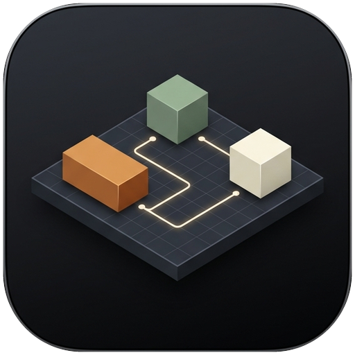
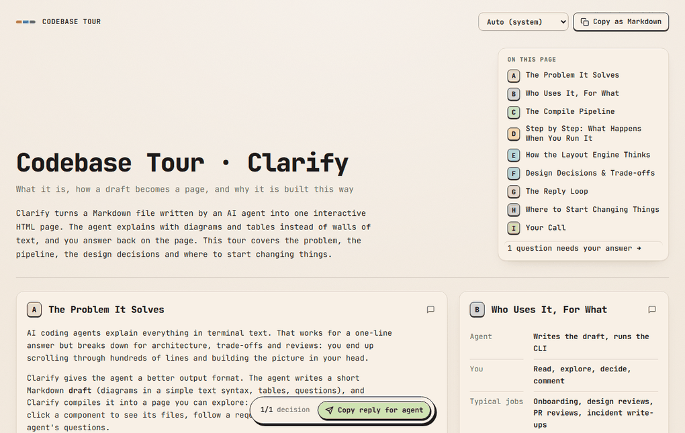
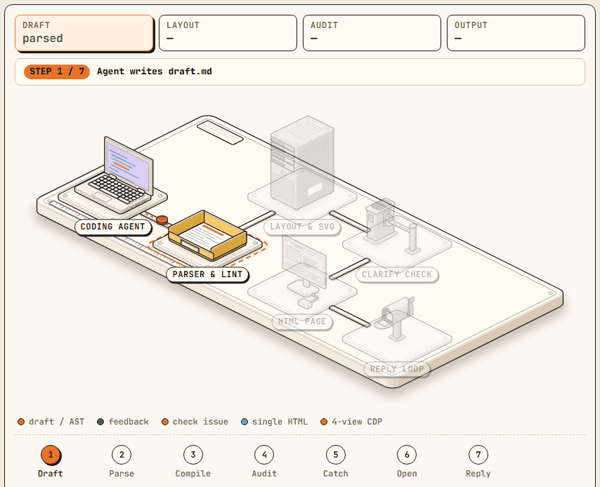
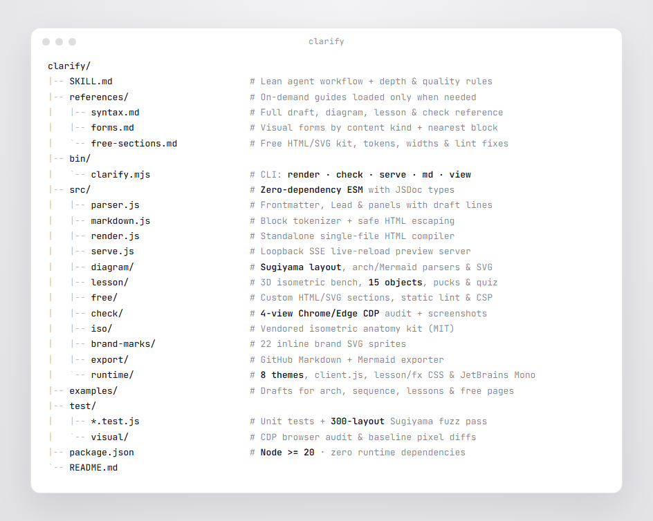

<p align="center">
  
</p>

<h1 align="center">clarify</h1>

<p align="center"><b>Turn AI agent Markdown drafts into interactive architecture boards, 3D lessons, and decision briefs.</b><br>
Your coding agent writes a short Markdown draft; Clarify compiles it into one offline HTML page with zero runtime dependencies —<br>
complete with Sugiyama auto-layout, narrated route tours, crafted 3D object lessons, browser checks, and a two-way reply loop.</p>

<p align="center">
  
  
  <a href="https://skills.sh/"></a>
  
  <a href="LICENSE"></a>
  <a href="https://github.com/KJ-AIML/clarify"></a>
</p>

<p align="center">
  <b><a href="#quick-start">Quick start</a></b> · <a href="#step-through-3d-lessons">3D lessons</a> · <a href="#core-capabilities">Capabilities</a> · <a href="#cli-and-block-formats">CLI &amp; formats</a> · <a href="#project-layout">Layout</a> · <a href="#testing-and-design-notes">Testing</a> · <a href="#license">MIT</a><br>
  <sub>Works with Antigravity · Claude Code · Codex · Cursor · Gemini CLI · Copilot CLI</sub>
</p>

<table>
  <tr>
    <td width="25%" valign="top">
      <b>Think &amp; Draft</b><br>
      The agent gathers verified facts, picks the right visual form per part, and writes a clean Markdown draft with <code>Lead:</code> first.
    </td>
    <td width="25%" valign="top">
      <b>Compile Offline</b><br>
      One zero-dependency Node CLI builds a single standalone HTML file with embedded JetBrains Mono, SVG diagrams, and 8 themes.
    </td>
    <td width="25%" valign="top">
      <b>Explore &amp; Check</b><br>
      Zoom, inspect components, play narrated route tours or 3D object steps — and verify every view automatically with <code>clarify check</code>.
    </td>
    <td width="25%" valign="top">
      <b>Reply to Agent</b><br>
      Pick options in <code>ask</code> blocks, comment on any node, edge, or step, and click <b>Copy reply for agent</b> with exact draft line numbers.
    </td>
  </tr>
</table>

<p align="center">
  
  <br>
  <sub>Clarify explaining itself (<a href="examples/codebase-tour.md"><code>examples/codebase-tour.md</code></a>): hover cards, inspector + review comments, narrated route tours, and structured agent replies.</sub>
</p>

## Quick start

Paste this into Antigravity, Claude Code, Codex, Cursor, or Gemini CLI and let your agent install it:

```text
Install clarify by running `npx skills add KJ-AIML/clarify -g`.
Then use `clarify` to walk me through this codebase's architecture.
```

Or install it yourself via the [`skills` CLI](https://skills.sh/):

```sh
npx skills add KJ-AIML/clarify -g    # install globally for Antigravity, Claude Code, Codex, Cursor, etc.
npx skills update clarify -g         # pull the latest version later
```

No `npx`? Clone this repository directly into your agent's skills directory (for example `~/.gemini/config/skills/clarify`, `~/.claude/skills/clarify`, or `~/.agents/skills/clarify`).

Then ask your agent naturally:

- *"Clarify how requests flow through `src/` and show where retries can duplicate side effects."*
- *"Build a step-through lesson explaining how a Git commit travels from my laptop to a teammate."*
- *"Compare these two database failover options in a Clarify decision brief with trade-offs."*
- *"Give me a codebase tour of this repo with narrated route tours."*

### Run the CLI directly

Requires **Node ≥ 20** and zero `npm install` (`check` uses your local Chrome or Edge via DevTools pipe; set `CHROME_PATH` if needed):

```sh
node bin/clarify.mjs render examples/ecommerce-architecture.md   # compile & open interactive board
node bin/clarify.mjs render examples/git-commit-lesson.md        # 3D object step-through lesson
node bin/clarify.mjs render examples/wireless-mouse.md           # custom free HTML/SVG sections
node bin/clarify.mjs check  examples/wireless-mouse.md           # 4-view browser check + screenshots
node bin/clarify.mjs serve  examples/platform-topology.md        # live-reload preview on save
node bin/clarify.mjs md     examples/checkout-sequence.md        # export GitHub Markdown + Mermaid
cat draft.md | node bin/clarify.mjs render - --out page.html --no-open
```

## Step-through 3D lessons

When explaining **how something moves between places over time** — a Git change, a network packet, a background job, or a layered command pipeline — a ```` ```lesson ```` block draws crafted isometric 3D objects on a bench, animates colored pucks along rails, updates live counters, illustrates failure cuts, and finishes with an interactive quiz:

<p align="center">
  
  <br>
  <sub>Clarify's own compile &amp; check pipeline drawn with its <code>lesson</code> 3D object bench (light theme) — 15 built-in 3D object kinds (<code>laptop</code>, <code>tray</code>, <code>server</code>, <code>gate</code>, <code>monitor</code>, <code>mailbox</code>, <code>database</code>, <code>queue</code>, <code>router</code>, <code>cloud</code>, and more). Try <a href="examples/git-commit-lesson.md"><code>examples/git-commit-lesson.md</code></a>.</sub>
</p>

## Core capabilities

| Capability | What it gives you |
| :--- | :--- |
| **Sugiyama auto-layout engine** | Layered layout with cycle breaking, crossing minimization, dedicated label lanes, and non-overlapping nested groups — fuzz-tested across 300 random layouts. |
| **Interactive canvas & inspector** | Pan, cursor-anchored zoom, pinch, keyboard navigation, minimap, fullscreen, neighborhood focus dimming, hover cards, and full component inspectors with file lists & incoming/outgoing jumps. |
| **Narrated route tours (`trace`)** | `trace "Checkout" { A -> B: narration }` turns any path into a colored transit line with a station strip and camera glide (`←`/`→` to step). |
| **Step-through 3D lessons (`lesson`)** | 15 isometric 3D object kinds, straight rail layouts, looping pucks (`change`, `reply`, `store`, `fail`, `slow`), live counter chips, failure cuts, recaps, and quizzes. |
| **Free sections (`free`) + no-network CSP** | When no built-in block fits, author scoped HTML/SVG/JS in the page's tokens and shared kit (`examples/wireless-mouse.md`), guarded by static lint (40 KB budget, raw colors, open tags, external URLs) and a zero-network CSP. |
| **4-view browser audit (`clarify check`)** | Drives local Chrome or Edge over DevTools pipe at `1440px` and `390px` (light & dark) to catch overflow, tiny text (`<10.5px`), overlap, clipping, low WCAG contrast, half-empty panels, missing panels, and runtime errors — saving per-panel PNGs. |
| **Two-way reply loop (`ask` + comments)** | Readers pick options and comment on any node, edge, panel, or lesson step; **Copy reply for agent** outputs structured `# Re:` feedback with exact draft line numbers. |
| **Mermaid in, Mermaid & assets out** | Paste Mermaid flowcharts/sequences unchanged; export standalone themed SVG, high-DPI PNG, per-diagram Mermaid, or full GitHub Markdown (`clarify md`). |
| **Live preview & 8 themes** | `clarify serve` live-reloads on draft or `file=` changes while preserving pan/zoom/scroll. Built-in themes: `auto`, `light`, `dark`, `tokyo-night`, `nord`, `catppuccin`, `paper`, and `blueprint`. |

> Visual craft inspired by [designed-to-scale](https://designed-to-scale.vercel.app): warm paper grain, embedded JetBrains Mono (consistent rendering on every machine), restrained small-caps labels, hard offset shadows on active states, and semantic status/route color tokens.

## CLI and block formats

| Command | Purpose |
| :--- | :--- |
| `clarify render <draft.md \| ->` | Compiles Markdown into `~/.clarify/pages/*.html` and opens it (`--out`, `--no-open`) |
| `clarify check <draft.md \| page.html>` | Runs static lint + 4-view headless Chrome/Edge audit and writes per-panel PNGs (`--out`) |
| `clarify serve <draft.md>` | Loopback-only live preview server with SSE reload on draft or `file=` edits |
| `clarify md <draft.md>` | Exports the whole brief to GitHub Markdown with Mermaid diagrams and alerts |

| Fence / block | Best used for | Reference |
| :--- | :--- | :--- |
| `arch` / `flow` / `mermaid` | System architecture, crate DAGs, nested groups, narrated `trace` routes | [references/syntax.md](references/syntax.md) |
| `sequence` | Request/response lifecycles, retries, `alt`/`opt`/`loop` branches | [references/syntax.md](references/syntax.md) |
| `lesson` | Step-by-step 3D object stories showing state moving across places + quiz | [SKILL.md](SKILL.md) · [references/syntax.md](references/syntax.md) |
| `free <name>` | Custom HTML/SVG explainers (rulers, grids, cutaways, timelines) using kit tokens | [references/free-sections.md](references/free-sections.md) · [references/forms.md](references/forms.md) |
| `ask` · `kv` · `tree` · `callout` | Reader decisions, key facts, directory trees, and takeaway callouts | [references/syntax.md](references/syntax.md) |

## Project layout

Plain ESM JavaScript with JSDoc types, zero build step, and zero runtime npm dependencies:

<p align="center">
  <picture>
    <source media="(prefers-color-scheme: dark)" srcset="docs/assets/layout-tree-dark.png">
    
  </picture>
</p>

## Testing and design notes

```sh
npm test                 # 260 unit tests, including the 300-layout Sugiyama fuzz pass & check tests
npm run visual           # CDP browser audit + baseline pixel diffs (no Playwright)
npm run visual:update    # regenerate baselines on this machine's fonts
```

> [!NOTE]
> **Windows visual tests:** Committed baselines in `test/visual/baselines/` were generated on macOS, so text metrics differ slightly on Windows. Run `node test/visual/run.mjs --baselines .tmp/before --output .tmp/out` to establish local Windows baselines in `.tmp/` (git-ignored) and diff against them cleanly.

The visual suite drives headless Chromium over `--remote-debugging-pipe` (finding `$CHROME_PATH`, Playwright's cache, or system Chrome/Edge and skipping cleanly if none is installed). Across 30 scenarios, 19 diff screenshots against baselines and 11 verify end-to-end behavior (the reply loop, SVG/PNG export, Thai label fitting, free-section zero-network CSP isolation, and the 3D lesson player).

<details>
<summary><b>Architecture &amp; implementation design notes (ESM/JSDoc, text metrics, security CSP, page size budget)</b></summary>

- **Plain ESM with JSDoc types:** Zero build step. `src/types.d.ts` defines shared contracts (`Graph`, `Layout`, `Draft`, …) referenced via `@typedef {import("./types")…}`, enabling editor intelligence and `tsc --checkJs` without transpiling.
- **Deterministic text measurement:** Node-side layout measures strings in the embedded monospace face (`0.6em` Latin, `1em` CJK, `0` non-spacing marks) and never underestimates proportional faces so Paper's serif theme stays within boxes; browser audits verify every label fits on screen.
- **Untrusted input & CSP isolation:** All draft text is HTML-escaped except inside ```` ```free ```` fences. Any page containing a free section embeds a strict no-network Content-Security-Policy (inline styles/scripts, `data:` fonts, `data:`/`blob:` images only). Markdown links allow only `http`/`https`/`mailto`/relative URLs, embedded JSON `<`-escapes script tags, and `clarify serve` binds strictly to loopback while rejecting foreign `Host` headers.
- **Only `check` drives a browser:** `render`, `serve`, and `md` never spawn Chromium — `render` and `serve` simply open the output in your default browser (`--no-open` disables opening). `clarify check` talks directly to Chrome or Edge over `--remote-debugging-pipe` with zero external packages.
- **Standalone output size:** Engine + 8 themes + inspector + route tours + exports + live reload = ~81 KB inlined CSS/JS, plus ~53 KB embedded JetBrains Mono (brand SVG paths deduplicated once as `<symbol>` sprites). Typical architecture briefs are ~165–215 KB, 3D lessons ~355–465 KB (adding ~36 KB lesson runtime + SVG stage), and multi-section free pages like `examples/wireless-mouse.md` ~254 KB (~8.5 KB shared `fx.css` kit + up to 40 KB per section).

</details>

## Learn more

- [SKILL.md](SKILL.md): lean agent workflow, depth rules (Quick vs. Designed), and lesson guidelines
- [references/syntax.md](references/syntax.md): complete draft, diagram, lesson, check, and reply-loop grammar
- [references/forms.md](references/forms.md): visual forms matched to content kinds, each with its nearest block
- [references/free-sections.md](references/free-sections.md): custom HTML/SVG kit, tokens, panel widths, and lint fixes
- [examples/](examples/): runnable drafts for [architecture](examples/ecommerce-architecture.md), [3D lesson](examples/git-commit-lesson.md), [free sections](examples/wireless-mouse.md), [codebase tour](examples/codebase-tour.md), [sequence](examples/checkout-sequence.md), [topology](examples/platform-topology.md), and [Mermaid](examples/mermaid-compat.md)

## License

[MIT](LICENSE) for Clarify's own code. Bundled brand marks are third-party trademarks with their own terms — see [THIRD_PARTY_NOTICES.md](THIRD_PARTY_NOTICES.md).
