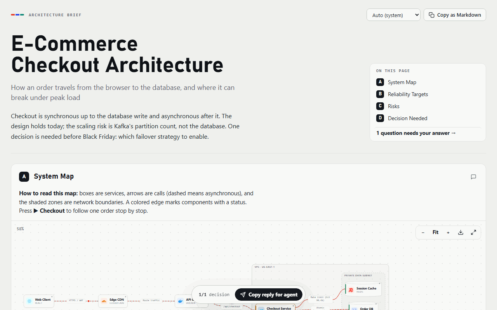

# Clarify

Interactive architecture and decision boards for AI coding agents. The agent writes a Markdown draft. Clarify compiles it into one self-contained HTML page with zero runtime dependencies.



- **A real layout engine.** Layered (Sugiyama) layout with cycle breaking, crossing minimization, label lanes, and nested boundary groups that never overlap. Fuzz-tested on 300 random layouts.
- **An interactive canvas.** Pan, cursor-anchored zoom, pinch, keyboard control, a minimap for large estates, fullscreen, and hover/selection focus that dims everything outside a node's neighborhood.
- **Hover cards and an inspector.** Hover any component (or Tab to it) for a quick card: what it is, its status, key facts, connection counts and the routes through it. Click for the full inspector, with files, every incoming and outgoing call (click to jump), and comments.
- **Narrated route tours.** `trace "Checkout" { A -> B: what happens… }` turns a request path into a guided tour. The path becomes a colored transit line, a station strip shows each stop with its narration, and the camera glides from hop to hop (←/→ to step).
- **Step-through lessons.** A ```` ```lesson ```` block teaches how something moves between places: crafted 3D objects on a bench, pucks riding the rails between them, counters that change, and a guide that walks through each step, a failure and its fix, a recap and a quiz. Try `examples/git-commit-lesson.md`.
- **Context built in.** The hero header has a section index and an open-questions count. Each diagram gets a map key that lists only the line styles and markers it actually uses. SKILL.md gives agents a context checklist: the answer first, how to read each map, node descriptions, a narrated main flow, and a takeaway per diagram.
- **Mermaid in, Mermaid out.** Paste Mermaid flowcharts and sequence diagrams unchanged. Every diagram exports back to Mermaid for GitHub.
- **A two-way agent loop.** Readers answer `ask` blocks and comment on any node, edge or panel. **Copy reply for agent** produces a structured reply with draft line numbers.
- **Exports.** SVG (standalone, themed), high-DPI PNG, Mermaid per diagram, and the whole page as GitHub Markdown.
- **Live preview.** `clarify serve draft.md` reloads the page on every save and keeps zoom, pan and scroll.
- **Eight themes.** Auto (system), Light, Dark, Tokyo Night, Nord, Catppuccin, Paper (e-ink), Blueprint.

The visual direction is the course look, after [designed-to-scale](https://designed-to-scale.vercel.app): warm paper with a faint grain, one monospace face for everything (JetBrains Mono, embedded so pages look the same on every machine), warm lines, small-caps labels, green for the active thing and a hard offset shadow on it. Color still means something: routes use their own line colors, statuses and brand marks keep theirs, and each panel key takes a folder color in turn. The named presets keep their palettes and take the same shapes; Paper keeps its serif.

## Install

```bash
npx skills add KJ-AIML/clarify -g    # Claude Code, Codex, Cursor and other agents
npx skills update clarify -g         # pull the latest version later
```

Then ask your agent to "clarify" or "diagram" something. No `npx`? Clone this repo into your agent's skills folder (for Claude Code, `~/.claude/skills/clarify`).

## Quick start

```bash
node clarify/bin/clarify.mjs render clarify/examples/ecommerce-architecture.md
node clarify/bin/clarify.mjs render clarify/examples/git-commit-lesson.md     # step-through lesson
node clarify/bin/clarify.mjs serve  clarify/examples/platform-topology.md     # live preview
node clarify/bin/clarify.mjs md     clarify/examples/checkout-sequence.md     # GitHub Markdown
cat draft.md | node clarify/bin/clarify.mjs render - --out page.html --no-open
```

Requires Node ≥ 20. No `npm install`.

Draft syntax: see [SKILL.md](SKILL.md) (what agents load) and [references/syntax.md](references/syntax.md) (the full reference). The `examples/` directory has one draft per feature area.

## Layout

```text
clarify/
├── SKILL.md, references/syntax.md   agent instructions (lean) + full reference (on demand)
├── bin/clarify.mjs                  CLI: render · serve · md · view
├── src/
│   ├── parser.js                    frontmatter, Lead, panels (with draft line numbers)
│   ├── markdown.js                  block tokenizer + safe inline formatter
│   ├── render.js                    page compiler, block renderers, grid row packing
│   ├── serve.js                     live-reload server (SSE, loopback only)
│   ├── types.d.ts                   shared contracts (Graph, Layout, Draft, …)
│   ├── diagram/
│   │   ├── arch-parser.js           Clarify diagram syntax
│   │   ├── mermaid.js               Mermaid flowchart/sequence parser + exporters
│   │   ├── layout.js                layered layout engine
│   │   ├── svg.js, sequence-svg.js  renderers (class-based, themed by CSS tokens)
│   │   └── index.js                 fence → model → SVG dispatch
│   ├── lesson/
│   │   ├── parse.js, state.js       lesson fence → model + warnings → one state per step
│   │   ├── layout.js, stage.js      bench layout → the stage, drawn once as SVG
│   │   ├── objects/, pen.js         the 15 crafted objects + their drawing helpers
│   │   ├── render.js, kinds.js      lesson HTML + runtime model; shared vocabulary
│   │   └── markdown.js              lesson → GitHub Markdown
│   ├── iso/kit.js, kit.css          vendored isometric anatomy kit (MIT)
│   ├── export/markdown.js           draft → GitHub Markdown
│   ├── brand-marks/brands.js        22 inline brand marks + lookup + sprite
│   └── runtime/                     themes.css, page.css, svg.css, client.js (inlined at compile time),
│                                    plus lesson.css and lesson.js on pages with a lesson;
│                                    fonts/ holds JetBrains Mono (Latin, 400 and 700, OFL), inlined into every page
└── test/
    ├── *.test.js                    node:test unit tests (parser, layout + fuzz, mermaid, render, serve, lessons)
    └── visual/                      CDP-driven browser audit + screenshot regression (no Playwright)
```

## Testing

```bash
npm test                 # 161 unit tests, including the 300-layout fuzz pass
npm run visual           # browser audit + pixel diff against test/visual/baselines
npm run visual:update    # accept intentional visual changes
```

The visual suite drives headless Chromium over the DevTools pipe. It finds Chromium through `$CHROME_PATH`, Playwright's browser cache or a system Chrome, and skips cleanly if none exists. Each scenario first runs in-page checks: no console errors, every node label fits its box, every tech node has an icon, and no horizontal page overflow. It then compares the screenshot against its baseline, and diff images go to `test/visual/output/`. Of the 26 scenarios, 17 compare a screenshot. The other 9 check behaviour end to end: the reply loop, SVG/PNG export, and the lesson player (stepping, motion and keys, reduced motion, round trips at rest, compact name tags, the quiz and step comments).

Baselines depend on the machine's fonts. Regenerate them with `npm run visual:update` on the machine (or CI image) that runs the comparison.

On Windows, run `node test/visual/run.mjs --baselines .tmp/before --output .tmp/out` instead of `npm run visual`: the committed baselines come from a Mac, so plain `npm run visual` fails on text rendering and writes any missing baselines into `test/visual/baselines/`. The first run fills `.tmp/before` (git-ignored), and later runs compare against it.

## Design notes

- **Plain ESM with JSDoc types.** There's no build step. `src/types.d.ts` defines the contracts, and modules reference them via `@typedef {import("./types")…}`, so editors and `tsc --checkJs` type-check without a compile pass.
- **Deterministic text measurement.** Node-side layout measures text in the page's monospace face: 0.6em per character, 1em for CJK, nothing for combining marks. The browser audit verifies that labels actually fit.
- **Untrusted input.** All draft text is escaped. Links are limited to http/https/mailto/relative URLs, and embedded JSON is `<`-escaped. The live server binds to loopback and rejects foreign `Host` headers.
- **Size.** The engine, eight themes, inspector, route tours, exports and live reload live in about 81 KB of inlined CSS and JS per page, and the embedded font adds about 58 KB. Brand paths are emitted once per page as a `<symbol>` sprite. Pages without a lesson are typically 170–220 KB. A page with a lesson is roughly 360–470 KB: it also carries the lesson player (about 36 KB of CSS and JS) and the stage, drawn as one SVG.

## License

[MIT](LICENSE) for Clarify's own code. The bundled brand marks are third-party trademarks with their own terms. See [THIRD_PARTY_NOTICES.md](THIRD_PARTY_NOTICES.md).
