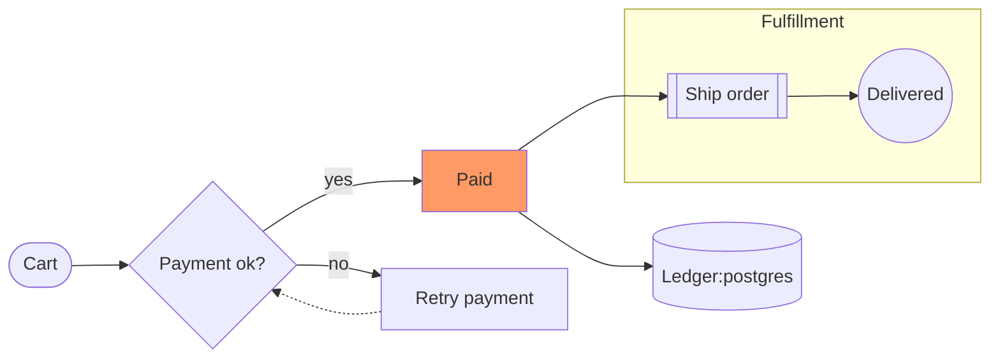
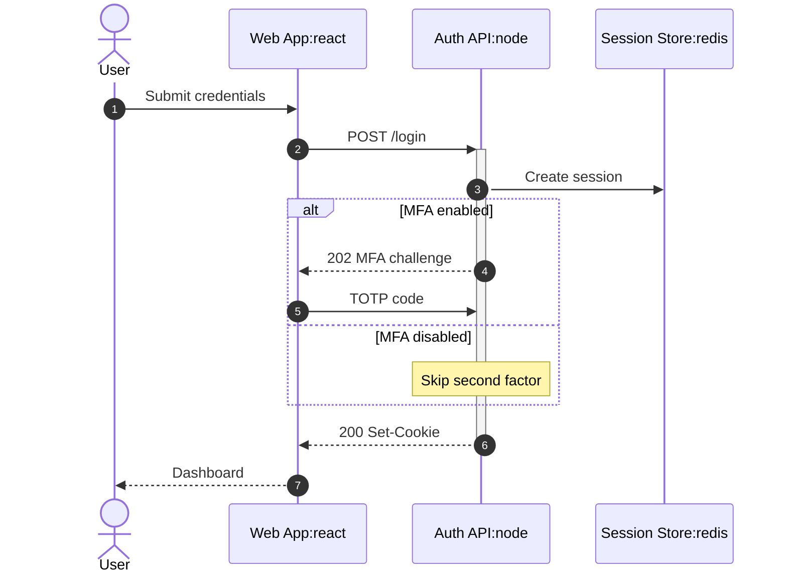

Lead: Paste existing Mermaid unchanged. Clarify lays it out with its own layered engine and adds pan, zoom, the inspector and exports.

## A Order State Machine (flowchart) {span=2}

## B Login Handshake (sequence)

## C What carries over
- Shapes: `[box]`, `(round)`, `([stadium])`, `[(database)]`, `{decision}`, `((circle))`
- Edges: `-->`, `---`, `-.->`, `==>`, `<-->`, `|labels|`, chains and `&`
- `subgraph … end` becomes a boundary box, nested to any depth
- Sequence: `participant`/`actor`, all arrow types, notes, `loop`/`alt`/`opt`/`par` frames, `autonumber`
- A `:tech` suffix on a label (`Ledger:postgres`) adds the brand icon
